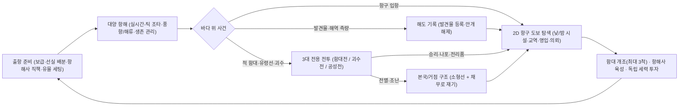

# 01. 핵심 게임 시스템 기획서 (Core Systems GDD)

본 문서는 『해도의 끝 (가제)』의 핵심 게임 루프, 실시간-틱 항해 물리, 하드코어 생존 및 재기 구조, 2D 항구 도보 탐색, 3척 정예 함대 기반 경제·조선, 확장 RPG 항해사, 그리고 패시브·규칙 변형형 해양 전설(40%) 메커니즘을 정의합니다.

---

## 1. 핵심 게임 루프 (Core Game Loop)

플레이어는 **항구에서의 철저한 출항 준비 → 광활한 대양의 생존과 탐험 → 3척 정예 함대 기반 전투·발견·교역 → 귀환 후 성장 및 독립 거점 확장**의 거시 루프를 반복합니다.

---

## 2. 대양 항해 & 풍향/해류 물리

### 2.1 실시간-틱 시간 체계 및 월드 스케일
- **조작 및 시간 흐름**:
  - 플레이어는 방향키/마우스/가상 패드로 기함의 진로(8방향 및 미세 조타)를 직접 조작하며, 요함(최대 2척)은 기함을 추종합니다.
  - **1 게임 일(Day) = 기본 배속(`1×`) 기준 약 4~5초**로 연속 경과합니다.
  - **시간 제어**: `일시정지(Pause / Space)` 상태에서 진로 점검·유물 교체·보급률 변경이 가능하며, 망망대해 공백을 쾌적하게 넘길 수 있도록 **`2×`, `4×` 가속**을 지원합니다. 조우·폭풍·식수 고갈 경보 시 자동 일시정지 옵션을 제공합니다.
- **광활한 원작급 월드 스케일**:
  - 지구 전역을 `32×32` 도트 타일 그리드로 표현하며, 경도 동서 방향은 끊김 없이 **구면 래핑(Horizontal Wrapping)** 됩니다.
  - 표준 범선 기준 **리스본 → 카리브해(신대륙) 항해에 약 20~30일**, **리스본 → 희망봉 → 인도양 캘리컷 항해에 약 55~75일**이 소요되는 묵직한 원정 스케일을 목표로 합니다.

### 2.2 풍향·해류 벡터 및 돛 물리
대양 타일은 **위도대별 계절풍(무역풍·편서풍·극동풍·적도 무풍대·인도양 몬순)**과 **해류 벡터(멕시코 만류·아굴라스 해류·쿠로시오 해류 등)** 데이터를 가집니다.

- **유효 항해 속도 공식**:
  $$\text{실제 속도} = \max\Big(0.15,\; \text{기본 추진력} \times \text{돛 효율}(\theta) \times \text{선체 적재 보정} + \text{해류 투영} + \text{유물/항해사 보정}\Big)$$
  - **횡범선 (카락·갤리온·보선 계열)**: 순풍(`θ ≤ 45°`)에서 속도 계수 `1.35×`로 압도적으로 빠르나, 정역풍(`θ ≥ 135°`)에서 `0.25×`로 급감합니다.
  - **종범선 (라틴 카라벨·지벡·개조 맹선 계열)**: 순풍 최고 속도는 `1.05×`로 낮지만, 역풍에서도 지그재그 태킹(`0.65×`)이 가능해 연안·역풍 해역 돌파에 유리합니다.
  - **동서양 하이브리드 선박**: 조선 주인공 또는 독립 세력 조선소에서 건조/개조 가능하며, **판옥선 평저 선체 + 서양 복합 범장(횡범+종범 혼합)**으로 역풍 페널티를 완화(`0.80×`)합니다.

### 2.3 시야, 안개(Fog of War), 측량 및 발견물
- **해도 안개**: 미탐험 해역은 양피지 질감의 미탐험 안개로 덮여 있습니다. 기함의 **망대 시야 + 망원경 등급 + 측량사 항해 레벨**에 비례해 안개가 걷히며, 항해도 비율(%)이 누적됩니다.
- **측량 정밀도와 항해 도구**:
  - **사분의 / 아스트롤라베**: 위도 오차 축소.
  - **회중시계 (크로노미터)**: 경도 표류 오차 제거(하드코어 모드에서는 경도 도구가 없으면 원양에서 실제 위치와 지도 표시 좌표가 어긋날 수 있음).
  - **청동 혼천의 (동방 도구)**: 야간·폭풍 시에도 천체 관측 가능, 해류 이상 징후 조기 탐지.
- **발견물 탐색**: 의심 해역이나 유적 연안에서 `탐색(Survey)` 명령 실행 시 측량사 능력치와 단서 보유 여부에 따라 고대 유적·희귀 생물·사라진 섬을 발견하고, 길드/학자 또는 본국에 보고하여 막대한 명성과 자금을 얻습니다.

---

## 3. 하드코어 생존 · 재난 · 재기 구조

### 3.1 일일 소모 및 배급률 제어
- **4대 소모품**: ① **식량(건빵·염장육)**, ② **식수(담수 통)**, ③ **수리용 목재**, ④ **탄약(일반 포탄/특수탄)**
- **일일 기본 소모량**:
  - `식량 소모 = 총 선원 수 × 1 단위 × 배급률`
  - `식수 소모 = 총 선원 수 × 1 단위 × 배급률 × 기온 계수` (적도·사막 연안 `1.4×`)
- **배급률 슬라이더 (`50% / 75% / 100%`)**:
  - `100%` (정상 배급): 선원 사기·체력 유지.
  - `75%` (절약 배급): 보급 일수를 33% 연장하나, 7일 이상 지속 시 매일 사기 `-2` 및 피로도 누적.
  - `50%` (비상 배급): 보급 일수를 2배로 연장하나, 매일 사기 `-5`, 질병 발병률 `2.5×`, 반란 게이지 급상승.

### 3.2 해상 재난 및 비상 생존 수단
| 재난 유형 | 발생 조건 | 피해 및 위험 | 대응 및 극복 수단 |
| --- | --- | --- | --- |
| **괴혈병 / 역병** | 식수 부족, 장기 원양(25일+), 쥐 발생 | 매일 선원 사망(1~5%), 사기 폭락 | **라임 주스(감귤류)** 사전 적재, 선의(항해사) 배치, 고양이 적재(쥐 억제) |
| **폭풍 셀** | 해역 기상 주기, 저주 유물 보유 시 빈도 급증 | 돛 파손, 선체 내구도 하락, 화물 유실, 항로 이탈 | 돛 접기(감속 대피), 수리 목재 투입, 성유물/조타수 스킬, 기상 관측 |
| **적도 무풍지대** | 적도 부근 정체 해역 진입 | 이동 불가로 식량·식수 고갈 | **노(Oar) 추진 가능 선박**(갤리·맹선), 기상 예보 우회, 빗물 받기 |
| **암초 / 유빙** | 얕은 연안, 안개, 극지방(고위도) 항해 | 선체 대파 및 침수 | 측량사 경보, 느린 속도 진입, 내빙 선체 개조(바크/북유럽 선박) |
| **선원 반란** | 사기 20 이하 지속, 급여 미지급, 저주 수치 초과 | 선원이 기함을 점거하려 함 → 진압 실패 시 강제 하선/난파 | 회계/수병장 진압 이벤트, 전리품 분배 약속, 항구 입항 후 주점 회식 |

- **비상 생존 수단**:
  - **낚시 & 빗물 받기**: 정지 또는 폭풍우 직후 일정 확률로 소량의 식량/식수 보충(선원 수에 비해 턱없이 부족해 단기 연명용).
  - **미개척 해안 상륙 보급**: 무인도·아프리카·신대륙 연안에 일시 상륙해 식수와 땔감, 열매를 채집(단, 원주민 기습 또는 열대병 리스크 동반).

### 3.3 조난·전멸 시 원작 스타일 재기 구조
하드코어 생존과 전투에서 함대 전멸(기함 침몰, 선원 전멸, 반란 축출)을 당하더라도 세이브 로드를 강제하지 않는 **재기 루프**를 제공합니다.
1. **구조 판정**: 가장 가까운 본국 항구, 동맹항, 또는 **플레이어 독립 거점 항구**의 어선/상선에 구조되어 강제 귀환합니다.
2. **재기 조건**:
   - 보유 중이던 함선(최대 3척)·화물·보급품은 상실됩니다(단, **주인공 핵심 서사 키 아이템·발견 기록·항해사 레벨·동료 유대**는 유지되며, 일부 동료는 흩어졌다가 술집에서 재합류).
   - 본국 왕실/조합/은행 또는 독립 거점 후원자로부터 **소형 1척(예: 소형 카라벨 또는 소형 맹선)과 구조 채무(빚)**를 안고 다시 출항하게 됩니다.
   - 만약 **플레이어에게 최소 1개 이상의 독립 거점 항구**가 남아있다면, 채무 부담이 대폭 완화되고 거점 항구의 비축 자금과 예비 선박으로 빠르게 재건할 수 있습니다.

---

## 4. 2D 항구 도보 탐색 & 경제·조선 루프

### 4.1 완전 도보 탐색과 낮/밤 사이클
- **도보 탐색 중심**: 항구에 입항하면 플레이어 캐릭터를 `32×32` 타일 기반 항구 마을에서 직접 조종해 걸어 다닙니다. (항구 내 빠른 이동 버튼은 제공하지 않고, 마을 골목·부두·시장·주점의 살아있는 분위기를 체감하는 원작 감성 채택)
- **시간대 변화 (새벽 / 낮 / 황혼 / 밤)**:
  - 항구 내부에서 걸어 다니거나 여관/술집 이용 시 시간이 흐릅니다.
  - **낮**: 왕궁·길드·교역소·조선소·아이템점 정상 영업.
  - **밤 (야간)**: 일반 관공서는 문을 닫는 대신, **뒷골목 야간 암시장(희귀 밀수품·저주 유물·은포탄)**, **심야 술집 밀담(해적 정보·카메오 NPC)**, **야간 침입/유령 소문 이벤트**가 열립니다.

### 4.2 9대 항구 시설 기능표
| 시설 | 주간/야간 | 핵심 기능 |
| --- | --- | --- |
| **1. 부두 (Harbor)** | 상시 | 4대 보급품 적재, 선원 배급률 설정, 함대 출항, 독립 항구 경우 요새/보급창 관리 |
| **2. 조선소 (Shipyard)** | 주간 | 선박 신조·중고 매매, **선실 배분 개조(포실/선원실/적재창)**, 대포·장갑·범장·선수상 교체, 파손 수리 |
| **3. 술집 (Tavern)** | 주·야간 | 선원 모집(지역별 숙련도 상이), **항해사 영입 및 친교**, 선원 사기 회복(회식), 해역/보물/괴수 소문 수집 |
| **4. 길드 (Guild)** | 주간 | 탐험·운송·토벌 의뢰 수주/보고, **발견물 감정 및 보상**, 항해도 계약(미탐험 해역 매각) |
| **5. 교역소 (Market)** | 주간 | 문화권 특산품·일반 교역품 매매, 시세 등락 확인, 면세 허가증 적용 |
| **6. 왕궁 / 총독부 (Palace)** | 주간 | 작위/사략 허가, 열강 외교 공헌도 확인, 투자(상업·공업도), **플레이어 독립 거점에서는 총독/내정 관리실** |
| **7. 여관 (Inn)** | 상시 | 선장·항해사 피로 회복, 시간 보내기(낮↔밤 전환), 수동 세이브 |
| **8. 아이템점 / 암시장** | 주간 / 야간 | 항해 도구(육분의/혼천의), 특수탄(은포탄/화전/작살), 유물 매매, **야간 한정 암시장 개방** |
| **9. 은행 / 상회 (Bank)** | 주간 | 예금(이자 수익), 대출 및 조난 구조 채무 상환, 대금 보관 |

### 4.3 3척 정예 함대 기준 선박 개조 & 경제 순환
- **함대 편성 철학**: 함선 상한이 **최대 3척(기함 1 + 요함 2)**이므로, 플레이어는 각 배의 용도를 극단적으로 특화할 수 있습니다.
  - 예: *1번 기함(다목적 밸런스 전함) + 2번 요함(적재창 극대화 대형 무역선) + 3번 요함(선원실·장갑 극대화 돌격 백병선)*
- **선실 커스터마이징**: 총 용적(Capacity) 안에서 `선원실 / 포실 / 적재창` 비율을 조선소에서 직접 재조정합니다. 단, 최소 선원 수 미달 시 속도가 급감하고 전투 불능이 됩니다.
- **교역과 항구 투자**:
  - 문화권(유럽·이슬람·아프리카·인도·동남아·동아시아·신대륙) 간 특산품 시세 차익과 계절·전쟁·유행 이벤트로 함대 유지 자금과 공성/개척 자금을 마련합니다.
  - 항구의 **상업도**(신규 교역품 등장)와 **공업도**(신규 선형·고급 대포·하이브리드 개조 해금)에 투자할 수 있습니다.

---

## 5. 확장 RPG 항해사 시스템

### 5.1 2축 레벨 및 능력치
모든 주인공과 영입 가능한 항해사(동료)는 독립적인 성장 트랙을 가집니다.
- **항해 레벨 (Navigation Lv)**: 항해 일수, 폭풍 돌파, 신규 해역·발견물 보고로 경험치 획득 → **조타, 측량, 협상, 회계, 조선 감각** 상승.
- **전투 레벨 (Combat Lv)**: 함대전, 거대 괴수전, 항구 공성전 승리로 경험치 획득 → **지휘력, 포술, 백병전 전술, 공성 지휘** 상승.

### 5.2 6대 직책 배정 시스템
함대의 정예화를 위해 보유한 항해사들에게 직책을 부여하면 시뮬레이션 공식에 직접 보정이 붙습니다.

| 직책 | 요구 역량 | 핵심 게임플레이 효과 |
| --- | --- | --- |
| **1등 부관 (First Mate)** | 지휘 · 항해 | 선원 사기 하락 억제, 반란 중재 확률 증가, 적 함대 정보 조기 파악 |
| **측량사 (Navigator)** | 측량 · 항해 | 위도/경도 오차 감소, 안개 해제 반경 확대, 암초·유빙 회피, 괴수 약점 탐지 보조 |
| **회계사 (Purser)** | 회계 · 협상 | 교역품 매매가 유리 보정(`±5~15%`), 일일 식량 절약, 항구 투자 효율 증가 |
| **포술장 (Master Gunner)** | 포술 · 전투 | 함대전/괴수전/공성전 포격 명중률·재장전·특수탄(화전·작살) 위력 증가 |
| **요함 선장 (Escort Captain)** | 지휘 · 항해 · 전투 | **요함(2번·3번 함) 1척당 1명 필수 배치** — 요함 AI 판단력·회피·백병전 효율 결정 |
| **항구 총독 (Port Governor)** | 협상 · 지휘 · 충성도 | **독립 세력 거점 항구에 주둔** — 세수, 치안, 방어전 지휘 보정 *(충성도 관리 필수)* |

### 5.3 성격 · 충성도 · 개인 서브 이벤트
- **성격 태그 (Personality)**: `충직`, `탐욕`, `호전`, `신중`, `학구`, `미신적`, `야심가` 등 1~2개 보유.
- **충성도 (`0~100`) 동적 변동**:
  - **상승**: 월급 정상 지급, 전리품 분배, 개인 가치관에 맞는 선택(예: 학구파 동료 앞에서 발견물 보고, 호전파 앞에서 해적 격파), 술집 회식/선물.
  - **하락**: 급여 체불, 저주 유물 장기 보유(`신중/충직` 하락), 비상 배급 장기화, 무모한 패주, 성격과 반대되는 악행/타협.
  - **이탈 / 배신**: 충성도 `20` 미만 시 술집 정박 중 탈영하거나, **총독으로 임명된 항구에서 반란/독립을 선포**할 수 있습니다.
- **핵심 동료 개인 서브 이벤트**:
  - 각 주인공의 초기 동료 및 주요 네임드 항해사는 특정 해역 도달·특정 충성도 달성·특정 연도 조건에서 **3단계 개인 퀘스트**가 해금됩니다. 완료 시 고유 패시브 특성 각성 및 최고 등급 충성도(`충성 맹세`)를 얻습니다.

---

## 6. 해양 전설 40% — 패시브·규칙 변형형 신비 시스템

『해도의 끝』에서 초자연적 요소는 화려한 마법 주문 버튼이 아니라, **16세기 선원들이 실제로 믿고 두려워하던 미신과 유물이 시뮬레이션의 물리·전투·생존 규칙을 뒤트는 형태**로 구현됩니다.

### 6.1 선수상 (Figureheads) — 선박 단위의 상시 규칙 변형
선박 선수에 장착하여 함선과 바다의 상호작용을 바꿉니다.

| 선수상 예시 | 희귀도 | 패시브 / 규칙 변형 효과 |
| --- | --- | --- |
| **목각 성모상 / 수호신상** | 일반~고급 | 폭풍 피해 `-20%`, 야간 사기 저하 억제, 유령선 공포 디버프 무효 |
| **해룡의 목각 두상** *(동방)* | 고급 | 역풍 및 연안 조류 저항 완화, 화전/화염 공격 위력 `+15%` |
| **침묵의 세이렌** | 희귀 | 아군 포격 피격률 감소(야간/안개 해역), 단 적 항해사 영입/협상 시 경계심 증가 |
| **검은 강철 충각수** | 전설 | 함대전 접현 돌격 시 선체 충돌 피해 추가, 항구 공성전 방벽 돌파력 강화 |

### 6.2 성유물 vs 저주 유물 (하이리스크 · 하이리턴)
기함 선장실 또는 보물고에 탑재하여 활성화합니다. (최대 탑재 슬롯: `기함 2개 + 요함 각 1개`)

| 유물 이름 | 분류 | 긍정 효과 (룰 변형) | 대가 / 리스크 (저주·부작용) |
| --- | --- | --- | --- |
| **성 베드로의 은나침반** | 성유물 | 악천후에서도 진로 이탈 없음, 아군 사기 일일 회복 `+1` | 해적 행위·상선 약탈 시 효과 일시 정지(타락 판정) |
| **블러드 골드 흉상** | 저주 유물 | 함대 전체 포격 화력 `+30%`, 나포 전리품 `+50%` | 폭풍 조우 확률 `2×`, 매주 저주 게이지 누적 → **선원 반란·유령선 습격 유도** |
| **크라켄의 말린 심장** | 괴수 전리품 | 거대 괴수전 시 아군 선원 공포 면역, 작살포 피해 `+25%` | 항구 정박 시 식량 부패 속도 증가, `신중/미신적` 항해사 충성도 지속 감소 |
| **부서진 황금 아스트롤라베** | 고대 유물 | 안개 해제 거리 `+2타일`, 사라진 섬·해저 유적 탐색 단서 공명 | 대양 무풍지대 조우 시 나침반 이상(수동 천체 관측 필요) |

### 6.3 16세기 선원 미신과 의식 (Superstition & Rituals)
항해 중 발생하는 기상·생태 징조는 단순 플레이버 텍스트가 아니라 실제 버프/디버프 상태이상으로 작동합니다.
- **세인트 엘모의 불 (돛대 끝 푸른 방전)**: 폭풍 전후 발동 → 3일간 유령선 조우 확률 증가, 대신 항해사 사기/경험치 보너스.
- **알바트로스 징조**: 원양에서 선원이 알바트로스를 사냥하면 즉시 식량 `+15`를 얻지만, **30일간 "바다의 저주" 상태이상** 부여(역풍 고정 + 선원 사기 하락).
- **출항 의식 (항구 신전/선원 축제/동방 해신제)**: 출항 전 비용을 들여 의식을 치르면 1회 원정에 한해 초기 사기 `+15` 및 첫 번째 대형 폭풍 피해 반감 효과를 얻습니다.
