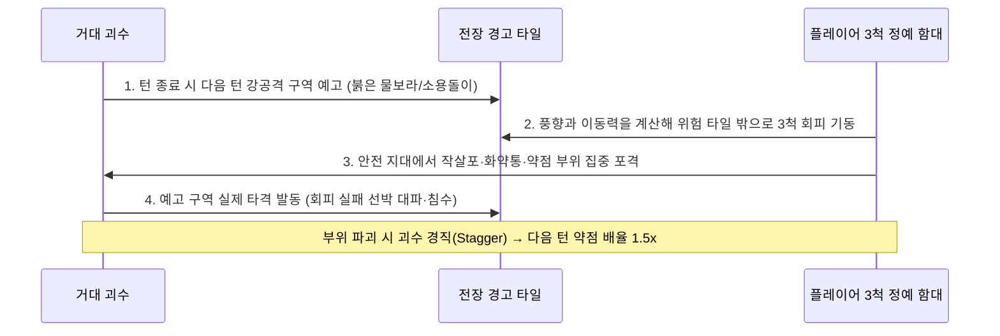

# 03. 전투 3종 및 독립 세력 내정 규칙서

본 문서는 **선장 일기토 삭제** 및 **최대 3척 함대 제한** 원칙 아래 설계된 3대 전용 전투 시스템(`NavalBattleScene`, `LeviathanBattleScene`, `PortSiegeScene`)의 상세 수치·공식과, 플레이어가 자신만의 해상 국가를 세우는 **독립 세력 건설 및 내정 규칙**을 정의합니다.

---

## 0. 전투 시스템 설계 원칙

1. **선장 일기토 완전 삭제**: 1:1 검투 미니게임으로 함대 전력 차이를 일거에 뒤집는 요소를 제거했습니다. 모든 결전은 **선박 화력, 기동, 선원 수와 무장도, 사기, 항해사 지휘력**이라는 함대 총력전으로 귀결됩니다.
2. **최대 3척 정예 함대 제한 (기함 1 + 요함 최대 2)**:
   - 플레이어가 바다에 띄울 수 있는 함선은 **최대 3척**입니다. (새 선박을 나포·구매할 때 이미 3척이면 1척을 매각/해체하거나 거점 항구에 예치해야 합니다.)
   - 3척 제한 덕분에 플레이어는 턴마다 기함을 직접 정밀 조종하고, 2척의 요함에 명확한 전술 명령을 내리며, 각 선박의 선실·대포·선수상·요함 선장을 뚜렷하게 특화할 수 있습니다.
3. **3종 전용 전투 씬 분리**: 일반 함대전, 거대 괴수전, 항구 공성전은 동일한 `SimulationCore` 상태(선체 HP, 선원, 사기, 탄약, 항해사)를 공유하되, 각 전투 성격에 최적화된 **전용 화면과 전용 전술 규칙**을 가집니다.

---

## 1. 함대 전술전 (`NavalBattleScene`)

### 1.1 전장 구조 및 턴 흐름
- **전장**: `24×18` 규모의 **8방향 사각 그리드** 해양 전술 맵 (지형 장애물: 암초·얕은 여울·안개 타일 포함). 전투 진입 시 대양 풍향과 풍속이 전장 전역에 반영됩니다.
- **선공 결정**:
  $$\text{선공 지수} = \text{기함 기본 추진력} + (\text{기함 선장 항해 Lv} \times 0.5) + \text{난수}(1\sim6)$$
  기선 제압 측의 함선들이 먼저 행동하거나, 선박별 기동 지수 순서에 따라 턴을 진행합니다.
- **턴당 이동력 공식**:
  $$\text{이동력(AP)} = \max\Big(1,\; \text{기본 추진력} + \text{풍향 보정} + \text{해류/선수상 보정} - \text{선체 파손 페널티}\Big)$$
  - **풍향 보정 (진행 방향 기준)**: 순풍 `+2`, 측풍 `+1`, 역풍 시 횡범선 `-2` / 종범선 `-1` / 하이브리드 선박 `-1` (최소 이동력 `1` 보장).
  - **선체 파손 페널티**: 선체 내구도 `50%` 미만 시 이동력 `-1`.
- **함선 1척의 턴 액션**: `[이동]` 후 `[행동 1회]` 선택:
  1. **포격 (Cannon Fire)**: 사거리 내 적 함선에 포문 발사.
  2. **접현 백병전 (Boarding)**: 상하좌우/대각선 인접 1타일 적 함선에 갈고리를 걸어 백병전 돌입.
  3. **응급 수리 / 대기**: 수리 목재를 소모해 내구도 일부 회복(`+10~15%`) 또는 사기 정비.
  4. **이탈 (Retreat)**: 전장 외곽 이탈 경계 타일에 도달 시 전장 이탈(기함 이탈 시 전투 패주 판정).

### 1.2 요함(최대 2척) AI 전술 명령 5종
기함은 플레이어가 직접 이동·포격·백병을 조작하며, 2번·3번 요함은 선장에 배치된 **요함 선장 항해사의 AI**가 플레이어의 전술 명령을 따릅니다. 전투 중 기함 턴 시작 시 언제든 명령을 바꿀 수 있습니다.

| 명령 | AI 행동 우선순위 | 선장 성격에 따른 미세 변주 |
| --- | --- | --- |
| **일제공격 (All-Out Attack)** | 사거리 내 가장 가까운 적에게 포격/접현 적극 시도 | `호전`: 선체 내구가 낮아도 돌진 / `신중`: 최대 사거리 유지 |
| **적 기함 집중 (Focus Flagship)** | 요함을 무시하고 적 기함만 최단 거리로 추적·공격 | 기함 조기 제압으로 전함대 나포를 노릴 때 최적 |
| **기함 호위 (Escort Flagship)** | 플레이어 기함 반경 2타일 이내를 유지하며 접근하는 적 요격 | 수송/측량 특화 요함이나 기함이 약할 때 필수 |
| **돌격 접현 (Boarding Charge)** | 포격을 건너뛰고 최단 이동으로 인접 접현 백병 시도 | 선원실·충각수 특화 돌격함에 적합 |
| **전술 퇴각 (Disengage)** | 적 사거리 밖 전장 외곽으로 이탈해 손실 방지 | 내구도 `30%` 이하 요함 보존용 |

### 1.3 대포 유형 테이블 및 포격 피해 공식
포실(Gun Slots)에 장착하는 대포 종류에 따라 사거리·화력·특수 효과가 달라집니다.

| 대포 유형 | 사거리(타일) | 기본 위력 | 특징 및 특수 효과 |
| --- | :---: | :---: | --- |
| **페드리로 (Pedrero)** | `1~2` | `중 (10)` | 저렴·경량, 초기 카라벨/소형선 적합 |
| **데미컬버린 (Demi-Culverin)** | `1~4` | `중상 (13)` | 균형 잡힌 중장거리 견제포 |
| **컬버린 (Culverin)** | `2~5` | `상 (16)` | 장거리 정밀 저격, 접근 전 적 돛·선체 견제 |
| **캐논 (Heavy Cannon)** | `1~2` | `최상 (24)` | 초근거리 압도적 선체 파괴력(대형선·공성 적합) |
| **천자총통 / 화전 (동방 화포)** | `1~3` | `중상 (15)` | 명중 시 **화재 상태이상** 부여(매 턴 지속 피해 + 유령선 유효타) |

- **포격 피해 공식**:
  $$\text{최종 피해} = \text{기본 위력} \times \Big(\frac{\text{탑재 포문 수}}{10}\Big) \times \text{명중 보정} \times \text{거리 감쇠} \times \text{유물/포술장 보정} \times (1 - \text{적 장갑 경감})$$
  - **명중 보정**: 포술장 전투 레벨, 풍랑, 적 선박 크기(소형일수록 회피율 상승) 반영.
  - **유령선 70% 내성 & 파훼 규칙**: 유령 함대는 일반 철포탄 피해를 `70%` 경감(`×0.3`)합니다. 이를 파훼하려면 ① **은포탄 / 축성탄** 소모(`100%` 정상 피해 + 추가 `25%` 정화 피해), ② 동방 **화전(화염)** 사용(`85%` 유효 피해), 또는 ③ **성 니콜라스의 유골함/성모상 선수상** 등 성유물 패시브를 활성화해야 합니다.

### 1.4 접현 백병전 & 나포 / 패주 처리
- **백병전 교환 공식**:
  $$\text{백병 전투력} = \text{현재 선원 수} \times \text{무장 등급 계수} \times \Big(1 + \frac{\text{지휘 항해사 전투 Lv}}{40}\Big) \times \Big(0.6 + \frac{\text{사기}}{200}\Big)$$
  양측 전투력 비율에 따라 상호 선원 손실이 발생하며, 선원이 `0`이 되거나 사기가 붕괴한 함선은 제압됩니다.
- **전투 종료 및 나포 규칙 (3척 제한 연동)**:
  - **적 기함 격침 또는 백병 제압 시**: 남은 적 요함은 전의를 상실해 전투가 즉시 승리 종료됩니다.
  - **나포 처리**: 아군 선박이 `3척 미만`일 경우 제압한 적 함선을 즉석에서 아군 요함으로 편입(최소 회항 선원 파견)할 수 있습니다. 이미 **3척이 가득 찬 경우**에는 ① 기존 아군 함선 1척과 교체(폐기)하거나, ② 나포선 화물·대포만 노획한 뒤 현장에서 매각/침몰 처리합니다.
  - **패배 및 조난**: 플레이어 기함이 침몰하거나 선원 전멸·항복 시 `01_GDD`에 정의된 **본국/독립 거점 구조 및 소형선·채무 재기 루프**로 전환됩니다. (단, 일반 해적/열강과의 전투 중 기함 내구도가 붕괴 직전일 때 금화·화물을 포기하고 `항복/통행료 지불`을 선택할 수 있는 협상 여지도 제공합니다.)

---

## 2. 거대 괴수전 (`LeviathanBattleScene`)

거대 괴수전은 일반 함대전 그리드가 아닌 **전용 보스 인카운터 화면과 전술 규칙**으로 진행됩니다.

### 2.1 전장 및 멀티타일 부위 시스템
- **보스 배치**: 화면 상단~중앙의 광활한 심해 격자(`16×12` 전술 해역)에 거대 괴수가 **여러 타일(`3×3` 또는 `4×2`)**을 점유하며 등장합니다.
- **독립 파괴 부위 (Parts)**: 괴수는 본체 HP 외에 고유한 부위를 가집니다.

| 괴수 예시 | 독립 부위 | 부위 파괴 시 전술 효과 |
| --- | --- | --- |
| **대서양 크라켄** | `전방 촉수 2` · `측면 촉수 2` · `눈/머리 본체` | 촉수 파괴 시 함선 포박 패턴 봉인 및 방어력 하락 |
| **폭풍의 레비아탄** | `등지느러미` · `가슴 비늘` · `턱(아구)` | 등지느러미 파괴 시 소용돌이 예고 범위 축소, 비늘 파괴 시 치명타 약점 노출 |
| **북해의 백경** | `꼬리 지느러미` · `흉부 껍질` · `머리` | 꼬리 손상 시 돌진 이동 거리 절반 감소 |
| **동중국해 이무기** | `화염 주머니` · `역린(몸통)` · `뿔/머리` | 화염 주머니 파괴 시 화염 브레스 예고 차단 |

### 2.2 위험 구역 예고(Telegraph) → 회피 → 집중 포격 사이클

- **전용 사냥 탄약 & 항해사 시너지**:
  - **작살포 (Harpoon)**: 명중 시 괴수의 다음 턴 이동/잠수 패턴을 1턴 봉인.
  - **화약통 투하 (Powder Keg)**: 괴수 돌진 예상 경로나 근접 타일에 투하해 폭발시키는 고위력 근접 병기.
  - **화전 / 은포탄**: 표피 재생 억제 및 영혼형/고대 괴수 추가 피해.
  - **생태 분석 (박물학/측량 항해사)**: 헨드릭의 동료 `잉그리드` 등 학구/측량 항해사가 탑승하면 1턴 차부터 **괴수의 약점 부위와 예고 패턴 확률**을 UI에 정확히 표시합니다.

---

## 3. 항구 공성전 (`PortSiegeScene`)

독립 세력 거점을 탈취하거나 적국 요새 항구(또는 전설의 안개 요새섬)를 함락시킬 때 진입하는 **전용 3단계 공성 씬**입니다. (**선장 일기토 없이** 함대 화력과 상륙 선원의 조직력으로 승부를 결정합니다.)

### 3.1 3단계 진행 구조
1. **Phase 1 — 외항 해안 포대 및 방어 함대 돌파**
   - 항구 입구의 좁은 수로에서 **고정 해안 포대**(장사거리·고화력·고내구)와 주둔 **방어 함대(최대 3척)**를 상대로 기동합니다.
   - 전략 선택: 정면으로 해안 포대를 포격 파괴해 안전을 확보할지, 종범/기동 선박으로 연막·역풍을 뚫고 내항 **상륙 지점(Landing Zone)**까지 강행 돌파할지 결정합니다.
2. **Phase 2 — 내항 상륙 & 성채 방어선 제압**
   - 상륙 지점에 선박이 접안하면 3척 함대에 남은 **가용 선원(최소 항해 인원 제외) + 상륙 공성 장비(공성 화약통·사다리)**를 투입해 성벽과 관문을 돌파합니다.
   - 상륙 전술 지휘는 함대 내 전투 레벨이 가장 높은 항해사(또는 수병장 직책)가 담당하며, 외항에서 포격으로 성벽 내구를 미리 깎아두었으면 상륙군 손실이 크게 줄어듭니다.
3. **Phase 3 — 총독·수비대장 본부 최종 백병 결전**
   - 1:1 일기토 대신, 성채 본부에 남은 수비대 잔여 병력과 상륙 선원 부대가 **총력 백병/화력 결전(사기·지휘력·장비·남은 함선 지원 포격 반영)**을 치릅니다.
   - 수비대 전력이 30% 미만으로 꺾이면 **항복 권고 → 점령 수용**을 선택해 민간 피해와 시설 파괴를 최소화하고 온전한 항구를 접수할 수 있습니다.

---

## 4. 독립 세력 건설 & 내정 시스템

플레이어는 6대 열강에 충성하는 대리인이 아니라, **자신만의 깃발과 독립 거점 항구, 요새, 전용 조선소, 자유 무역망**을 구축할 수 있습니다.

### 4.1 거점 항구 확보 경로 2가지
| 확보 경로 | 조건 및 과정 | 장단점 및 파급 효과 |
| --- | --- | --- |
| **무력 공성 점령** | 기존 열강/해적 항구를 `PortSiegeScene`으로 함락 | 즉시 성숙한 상업·조선 기반 획득 / **원래 지배 열강과 즉시 전쟁 상태 돌입**, 주기적 **토벌 함대 파견** |
| **무인도 개척 / 자본 독립** | 미개척 보급항에 목재·자금·개척민 투자, 또는 군소 중립항에 막대한 자본+민심 확보로 독립 선포 | 초기 시설이 빈약해 단계적 증축 필요 / 열강과의 전면 적대 리스크가 낮고 원하는 입지(희망봉·카리브·동중국해 요충) 선점 가능 |

### 4.2 독립 거점 핵심 4대 지표
1. **총독 임명 & 충성도 관리**:
   - 보유한 항해사 중 1명을 **항구 총독**으로 파견합니다. (총독이 된 항해사는 함대 3척 승선에서 빠져 거점에 상주합니다.)
   - 총독의 **협상/지휘 능력치**가 세수와 수비군 효율을 올리며, **충성도가 `25` 미만으로 떨어지거나 봉급·방어가 방치되면 항구를 쥐고 배신(독립 이탈)**할 수 있습니다.
2. **요새 & 해안 포대 방어 등급 (`Lv 1 ~ Lv 5`)**:
   - 적국 토벌 함대가 거점을 역공할 때 자동 요격(또는 플레이어가 직접 귀환해 방어전 합류). 등급이 높을수록 포대 수와 성벽 내구도가 강해지나 월간 유지비가 상승합니다.
3. **전용 조선소 & 보급창 (핵심 특혜)**:
   - 플레이어 독립 거점에서는 **함대 무료/원가 수리 및 4대 보급(식량·식수·목재·탄약) 비축분 보급**이 가능합니다.
   - 거점 공업도가 일정 수준에 오르면 **독립 세력 전용 하이브리드 개조**(동서양 복합 범장, 장갑 강화, 3척 외 예비 함선 최대 3척 계류 보관소)가 해금됩니다.
4. **세율 & 민심 (`0~100`)**:
   - 세율(`저율 / 표준 / 중과세`)에 따라 월간 세수와 항구 상인 유입(시세 활력)이 달라집니다. 민심이 `20` 미만이면 폭동으로 시설 가동이 중단됩니다.

### 4.3 월말 재정 정산 수식
매월 말일(30일/31일) 0시에 플레이어의 모든 독립 거점이 일괄 정산되어 국고(또는 플레이어 은행 계좌)에 반영됩니다.

$$\text{항구 월 순수익} = \Big(\text{기본 관세} \times \text{상업도 보정} \times \text{세율} + \text{특산품 배당}\Big) - \Big(\text{요새 유지비} + \text{수비대 급여} + \text{총독 봉급}\Big)$$

- **설계 의도**: 무작정 수많은 항구를 점령하면 요새 유지비와 수비대 급여, 열강 토벌 함대 방어 비용 때문에 적자가 폭발합니다. 따라서 플레이어는 **교통 요충지(지중해·카리브·희망봉·말라카·동중국해 등)의 소수 정예 거점 2~4곳**을 알차게 키우고, 그 거점을 발판 삼아 3척 정예 함대로 세계 바다를 제패하도록 유도합니다.
