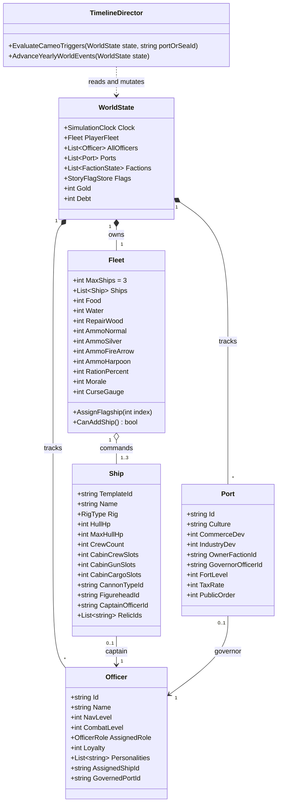
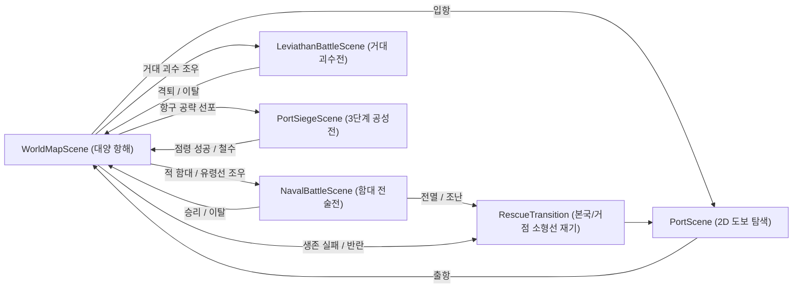

# 04. Godot 4 (.NET / C#) 기술 아키텍처 및 데이터 스키마

본 문서는 『해도의 끝 (가제)』의 **순수 C# 시뮬레이션 코어와 Godot 4 뷰 레이어 분리 아키텍처**, **`960×540` 고밀도 레트로 렌더링 규격**, **100+ 항구 도보 맵 모듈화 전략**, 그리고 **100% JSON 데이터 주도 스키마**를 정의합니다.

---

## 1. 솔루션 및 프로젝트 폴더 구조

엔진 실행 없이도 복잡한 항해·생존·전투·교차 타임라인·월말 정산 로직을 단위 테스트할 수 있도록 **Clean Separation(관심사 분리)** 구조를 채택합니다.

```text
c:\game\EdgeOfTheChart\
├── EdgeOfTheChart.sln              # 전체 .NET 솔루션
├── docs/                           # 마스터 기획서 세트 (본 문서 포함)
├── data/                           # 100% JSON 마스터 데이터 테이블
│   ├── ports.json                  # 항구, 문화권, 특산품, 초기 지배 세력
│   ├── ships.json                  # 선박 원형, 범장 타입, 선실 용적
│   ├── officers.json               # 항해사, 성격, 직책 보정, 서브퀘스트 키
│   ├── relics_and_figureheads.json # 성유물/저주 유물/선수상 패시브 수정자
│   ├── leviathans.json             # 거대 괴수, 멀티타일 부위, 예고 패턴
│   ├── trade_goods.json            # 교역품, 기준가, 문화권 산출 가중치
│   └── scenarios/                  # 6인 주인공 + 카메오 교차 타임라인 JSON
│       ├── diego_ch1.json
│       └── ...
├── src/
│   └── SimulationCore/             # 순수 C# .NET 8 클래스 라이브러리 (Godot 참조 0%)
│       ├── Clock/                  # SimulationClock, 일시정지/2x/4x 틱 계산
│       ├── World/                  # WorldState, 풍향/해류 격자, 안개(FogOfWar)
│       ├── Fleet/                  # Fleet(MaxShips = 3), Ship, 보급/배급/재난/재기
│       ├── Officers/               # Officer, 직책 보정, 충성도/성격 엔진
│       ├── Combat/                 # NavalBattleEngine, LeviathanEngine, PortSiegeEngine
│       ├── Factions/               # 열강 외교, 독립 거점, 총독, 월말 수지 계산
│       ├── Narrative/              # StoryFlagStore, TimelineDirector(카메오/연도 트리거)
│       ├── Relics/                 # 패시브/저주 수정자 규칙 파이프라인
│       └── Serialization/          # SaveSnapshot (JSON 직렬화/버저닝)
├── tests/
│   └── SimulationCore.Tests/       # xUnit 자동 테스트 (`dotnet test`)
├── godot/                          # Godot 4 (.NET) 프레젠테이션 프로젝트
│   ├── project.godot
│   ├── assets/                     # sprites, tilesets, portraits, audio, fonts
│   │   ├── placeholders/           # Phase 1~4 프로토타입용 코드생성/CC0 에셋
│   │   └── production/             # Phase 6 최종 도트/초상화/BGM 교체 디렉터리
│   ├── scenes/
│   │   ├── main/                   # MainRoot, SceneRouter
│   │   ├── world_map/              # WorldMapScene (TileMapLayer + HUD)
│   │   ├── port/                   # PortScene + 6대 문화권 템플릿 + 커스텀 거점
│   │   ├── combat/                 # NavalBattleScene, LeviathanBattleScene, PortSiegeScene
│   │   └── ui/                     # EventOverlay, ChartOverlay, FleetManagePanel
│   └── scripts/                    # Godot Node C# 어댑터 (Core 상태 렌더링 및 입력 전달)
└── tools/
    └── mapgen/                     # Python + Natural Earth GIS → 32×32 월드 타일맵 생성기
        ├── generate_world_map.py
        └── wind_current_baker.py
```

---

## 2. 고밀도 레트로 렌더링 & 항구 도보 맵 아키텍처

### 2.1 `960×540` 픽셀 파이프라인 및 입력 추상화
- **기준 해상도**: `960 × 540` (16:9 와이드, 가로 30타일 × 세로 17타일 가시 영역, `32 × 32` 타일 기준)
  - `1920×1080` (FHD)에서 정확히 **2배 정수 배율**
  - `3840×2160` (4K)에서 정확히 **4배 정수 배율**
- **Godot 프로젝트 설정 규격**:
  - `display/window/size/viewport_width = 960`
  - `display/window/size/viewport_height = 540`
  - `display/window/stretch/mode = "viewport"` (픽셀 일관성 보장)
  - `display/window/stretch/scale_mode = "integer"` (PC 창/전체화면 레터박스 최소 정수 스케일, 모바일 가로 화면에서는 `expand` 옵션 허용)
  - `rendering/textures/canvas_textures/default_texture_filter = Nearest` (도트 선명도 유지)
- **PC/모바일 입력 추상화 (`IInputCommandSource`)**:
  - PC: 키보드(`WASD`/화살표 조타·도보, `Space` 일시정지, `1/2/3` 배속) + 마우스(전투 그리드 타일 선택, UI 조작)
  - 모바일(후속 확장): 화면 좌측 하단 가상 조이스틱(터치 스틱) + 우측 하단 상황 버튼(`상호작용/입항/정지`) + 그리드 직접 탭

### 2.2 100+ 항구 도보 탐색 맵 모듈화 전략
전 세계 100여 개 항구마다 완전 도보 탐색 맵을 일일이 수작업하면 개발 병목이 발생합니다. 이를 해결하기 위해 **2계층 항구 맵 구조**를 사용합니다.

1. **6대 문화권 모듈형 타일 템플릿 (`PortTemplate`)**:
   - `iberia` (이베리아), `mediterranean` (지중해), `north_europe` (북유럽), `islamic` (이슬람/오스만), `new_world` (신대륙), `east_asia` (동아시아)
   - 각 문화권마다 **소형(보급항) / 중형(무역항) / 대형(수도·요새항)** 레이아웃 프리셋(3종)을 제작해두고, JSON의 `port_size`·`culture`·`facilities` 배열에 따라 시설 입구 포탈과 NPC 스폰 지점을 자동 배치합니다.
2. **핵심 거점 전용 커스텀 맵 (`CustomPortScene`)**:
   - 6인 주인공의 출발지 및 주요 스토리 거점(리스본·세비야·암스테르담·베네치아·런던·부산포·이스탄불·알렉산드리아·캘리컷 등 약 12~15곳)은 고유 랜드마크와 비밀 골목이 있는 **전용 수작업 씬**으로 오버라이드합니다.
3. **낮/밤 시간대 팔레트 및 NPC 스케줄러**:
   - `CanvasModulate` 색상 그라데이션(새벽/낮/황혼/밤) + 항구 가로등 `PointLight2D` 토글.
   - `PortNpcSchedule` 테이블에 따라 주간 관공서 NPC는 퇴근하고, 야간 암시장 상인·밀수 브로커·카메오 NPC가 뒷골목에 스폰됩니다.

---

## 3. 핵심 C# 도메인 모델 & 씬 라우터

### 3.1 `SimulationCore` 도메인 클래스 다이어그램



### 3.2 `SceneRouter` 씬 상태 전이 및 세이브 스냅샷
`MainRoot` 아래의 `SceneRouter`는 `SimulationCore`가 발행한 도메인 이벤트에 따라 Godot 씬을 전환합니다.



- **오버레이 레이어**: `EventOverlay` (카메오 대화·서사 컷신·재난 알림) 및 `ChartOverlay` (세계 항해도·발견물 도감·항해 일지)는 씬을 언로드하지 않고 최상위 캔버스 레이어에서 시뮬레이션을 일시정지한 채 표시합니다.
- **JSON 세이브/로드 버저닝**:
  - 세이브 파일(`save_slot_N.json`)은 `WorldState` DTO 전체를 `System.Text.Json`으로 직렬화합니다.
  - 루트 필드에 `"save_version": 1`을 포함하며, 향후 스키마 변경 시 `SaveMigrationPipeline`이 구버전 세이브를 최신 DTO로 자동 보정합니다.
  - 시뮬레이션과 뷰가 분리되어 있으므로 **전투 씬 진입 직전 자동 저장(`autosave_pre_battle.json`)** 및 여관 수동 저장이 즉각적이고 결정론적(Deterministic)으로 복원됩니다.

---

## 4. 핵심 JSON 데이터 스키마 샘플

모든 밸런스 수치, 선박, 항해사, 유물, 괴수, 주인공 시나리오는 `data/` 폴더의 JSON 파일로 정의하며 코드 수정 없이 확장 가능합니다.

### 4.1 `data/ports.json` (항구 및 문화권 템플릿 매핑)
```json
{
  "ports": [
    {
      "id": "port_lisbon",
      "name_ko": "리스본",
      "culture": "iberia",
      "size": "capital",
      "custom_scene": "res://scenes/port/custom/PortLisbon.tscn",
      "world_tile": { "x": 412, "y": 198 },
      "owner_faction": "faction_portugal",
      "commerce_dev": 82,
      "industry_dev": 75,
      "fort_level": 4,
      "facilities": ["harbor", "shipyard", "tavern", "guild", "market", "palace", "inn", "item_shop", "bank"],
      "specialties": ["good_olive_oil", "good_cork", "good_port_wine"]
    },
    {
      "id": "port_busanpo",
      "name_ko": "부산포",
      "culture": "east_asia",
      "size": "major",
      "custom_scene": "res://scenes/port/custom/PortBusanpo.tscn",
      "world_tile": { "x": 918, "y": 211 },
      "owner_faction": "faction_joseon",
      "commerce_dev": 55,
      "industry_dev": 68,
      "fort_level": 4,
      "facilities": ["harbor", "shipyard", "tavern", "guild", "market", "palace", "inn", "item_shop", "bank"],
      "specialties": ["good_ginseng", "good_celadon", "good_silk"]
    }
  ]
}
```

### 4.2 `data/ships.json` (선박 원형 및 범장·선실 규격)
```json
{
  "ships": [
    {
      "id": "ship_caravel_latina",
      "name_ko": "라틴 카라벨",
      "culture_origin": "iberia",
      "rig_type": "lateen",
      "base_speed": 6,
      "turn_ap": 5,
      "max_hull_hp": 180,
      "armor": 8,
      "total_capacity": 160,
      "min_crew": 12,
      "default_cabins": { "crew": 45, "guns": 15, "cargo": 100 },
      "max_gun_slots": 24,
      "ice_resistant": false,
      "oar_assisted": false,
      "base_price": 4500,
      "sprite_id": "ship_caravel_latina"
    },
    {
      "id": "ship_joseon_haeryong_hybrid",
      "name_ko": "개조 맹선 (초기 판옥형)",
      "culture_origin": "east_asia",
      "rig_type": "hybrid",
      "base_speed": 5,
      "turn_ap": 4,
      "max_hull_hp": 240,
      "armor": 14,
      "total_capacity": 200,
      "min_crew": 18,
      "default_cabins": { "crew": 70, "guns": 30, "cargo": 100 },
      "max_gun_slots": 36,
      "ice_resistant": false,
      "oar_assisted": true,
      "base_price": 8200,
      "sprite_id": "ship_haeryong_hybrid"
    }
  ]
}
```

### 4.3 `data/officers.json` (확장 RPG 항해사)
```json
{
  "officers": [
    {
      "id": "off_goncalo_alves",
      "name_ko": "곤살루 알베스",
      "nationality": "faction_portugal",
      "nav_level": 6,
      "combat_level": 4,
      "stats": { "helm": 78, "survey": 65, "negotiate": 52, "gunnery": 48, "leadership": 74 },
      "personalities": ["loyal", "cautious"],
      "initial_loyalty": 90,
      "recruit_cost": 0,
      "recommended_role": "first_mate",
      "personal_quest_id": "quest_goncalo_cape_grave",
      "portrait_id": "portrait_off_goncalo"
    },
    {
      "id": "off_choi_mugang",
      "name_ko": "최무강",
      "nationality": "faction_joseon",
      "nav_level": 4,
      "combat_level": 7,
      "stats": { "helm": 55, "survey": 40, "negotiate": 38, "gunnery": 86, "leadership": 72 },
      "personalities": ["righteous", "craftsman"],
      "initial_loyalty": 88,
      "recruit_cost": 0,
      "recommended_role": "master_gunner",
      "personal_quest_id": "quest_choi_twin_dragon_cannon",
      "portrait_id": "portrait_off_choi_mugang"
    }
  ]
}
```

### 4.4 `data/relics_and_figureheads.json` (패시브·규칙 변형 신비)
```json
{
  "items": [
    {
      "id": "relic_aztec_sun_disc",
      "slot_type": "relic",
      "category": "cursed",
      "name_ko": "저주받은 아즈텍 태양판",
      "modifiers": [
        { "stat": "cannon_damage_mult", "op": "add", "value": 0.30 },
        { "stat": "capture_gold_mult", "op": "add", "value": 0.40 },
        { "stat": "storm_chance_mult", "op": "mul", "value": 2.0 },
        { "stat": "weekly_curse_gain", "op": "add", "value": 12 }
      ]
    },
    {
      "id": "fig_wooden_haeryong",
      "slot_type": "figurehead",
      "category": "eastern_legend",
      "name_ko": "해룡의 목각 두상",
      "modifiers": [
        { "stat": "headwind_penalty_reduction", "op": "add", "value": 0.25 },
        { "stat": "fire_arrow_damage_mult", "op": "add", "value": 0.15 }
      ]
    }
  ]
}
```

### 4.5 `data/leviathans.json` (멀티타일 괴수 & 예고 패턴)
```json
{
  "leviathans": [
    {
      "id": "levi_atlantic_kraken",
      "name_ko": "대서양 크라켄",
      "grid_footprint": { "width": 3, "height": 3 },
      "weak_ammo": ["ammo_harpoon", "ammo_powder_keg"],
      "parts": [
        { "id": "part_tentacle_front", "name_ko": "전방 촉수군", "hp": 220, "on_destroy": "disable_grapple_pattern" },
        { "id": "part_tentacle_flank", "name_ko": "측면 촉수군", "hp": 200, "on_destroy": "reduce_evasion" },
        { "id": "part_head", "name_ko": "거대 두부", "hp": 500, "armor": 12, "is_core": true }
      ],
      "telegraph_patterns": [
        { "id": "pat_maelstrom_slam", "name_ko": "심해 촉수 강타", "telegraph_turns": 1, "damage": 95, "aoe_shape": "cross_3x3" }
      ]
    }
  ]
}
```

### 4.6 `data/scenarios/diego_ch1.json` (시나리오 & 카메오 교차 트리거)
```json
{
  "scenario_id": "diego_ch1",
  "protagonist_id": "hero_diego",
  "events": [
    {
      "id": "evt_cameo_gibraltar_1522",
      "type": "cameo_crossroad",
      "conditions": {
        "min_year": 1522,
        "max_year": 1524,
        "region": "strait_of_gibraltar",
        "required_flag_false": "done_evt_cameo_gibraltar_1522"
      },
      "cast": ["hero_diego", "hero_isabel", "off_goncalo_alves"],
      "choices": [
        {
          "label": "붉은 돛의 카라벨 도주를 엄호한다",
          "effects": [
            { "set_flag": "isabel_helped_gibraltar" },
            { "relation": { "target": "faction_spain", "delta": -15 } },
            { "cameo_affinity": { "target": "hero_isabel", "delta": 30 } }
          ]
        },
        {
          "label": "스페인 순찰 함대에 항로를 알린다",
          "effects": [
            { "set_flag": "isabel_betrayed_gibraltar" },
            { "relation": { "target": "faction_spain", "delta": 20 } },
            { "cameo_affinity": { "target": "hero_isabel", "delta": -50 } }
          ]
        }
      ]
    }
  ]
}
```

---

## 5. 단계적 하이브리드 아트 · 오디오 파이프라인

초기 단계부터 방대한 도트 리소스를 전부 제작하다 중도 포기하는 위험을 피하기 위해 **ID 기반 에셋 매니페스트(`AssetCatalog`)**를 운영합니다.

- **Phase 1~4 (프로토타이핑 규약)**:
  - 코드나 스크립트로 생성한 색 구분 플레이스홀더 타일(육지·얕은 바다·원양·항구·유적)과 무료 CC0 레트로 에셋을 `godot/assets/placeholders/`에 배치합니다.
  - 모든 JSON은 파일 경로 대신 논리 ID(`"sprite_id": "ship_caravel_latina"`)만 참조합니다.
- **Phase 6 (전용 아트·오디오 무중단 교체)**:
  - `AssetCatalog`의 매핑 경로를 `placeholders/`에서 `production/`의 최종 32×32 픽셀 타일, 96×96/128×128 도트 초상화, 치프튠/FM 신스(16-bit 감성) 레트로 BGM으로 일괄 교체하면 코드와 씬 로직 수정 없이 비주얼이 업그레이드됩니다.

---

## 6. GIS 월드맵 자동 생성 파이프라인 (`tools/mapgen/`)

1. **원본 데이터**: 공개 도메인 **Natural Earth 1:50m 해안선/육지 폴리곤**을 입력으로 사용합니다.
2. **래스터화**: Python(`shapely` + `Pillow`/`numpy`) 스크립트로 지구 전역을 `32×32` 타일 규격의 `1200 × 600` 안팎 격자(원작급 광활한 대양 스케일 맞춤)로 래스터화하고, 파나마/수에즈 지협 등 16세기 항로 핵심 지형을 검증·보정합니다.
3. **물리 레이어 베이킹**: 위도대별 무역풍/편서풍/몬순 방향과 주요 해류 벡터, 수심(연안 암초 vs 심해)을 JSON/바이너리 청크로 구워 `SimulationCore`와 Godot `TileMapLayer`가 즉시 읽을 수 있게 출력합니다.
