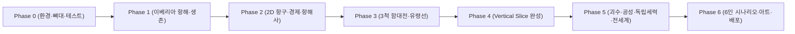

# 05. 단계별 개발 로드맵 및 리스크 관리 (Phase 0 ~ Phase 6)

본 문서는 6인 주인공·3대 전용 전투·전 세계 100+ 항구·독립 세력 건설이라는 방대한 비전을 완주하기 위한 **단계별 개발 로드맵**입니다. 핵심 원칙은 **이베리아·서지중해 좁은 해역에서 주인공 1명으로 전체 루프를 먼저 완성(Vertical Slice)**해 재미와 밸런스를 검증한 뒤, 전 세계와 6인·괴수전·공성전으로 확장하는 것입니다.

---

## 1. 전체 마일스톤 흐름 및 개요표

| 단계 | 핵심 목표 | 주요 산출물 |
| :---: | --- | --- |
| **Phase 0** | 개발 환경 구축 & 솔루션 뼈대 | Godot 4 (.NET) + .NET 8 SDK, Git 초기화, `SimulationCore` + xUnit, `960×540` 픽셀 테마, JSON 로더 & 세이브/로드 |
| **Phase 1** | 대양 항해 & 하드코어 생존 프로토타입 | 이베리아·서지중해 테스트 맵(12~15항구), 실시간-틱 조타, 풍향/해류, 식량/식수·재난·구조 재기, 안개 해제 |
| **Phase 2** | 2D 항구 도보 탐색 & 경제·항해사 | 문화권 모듈 항구 씬 + 리스본/세비야 커스텀 맵, 낮/밤·야간 암시장, 9대 시설, 3척 조선·개조, 확장 RPG 항해사 |
| **Phase 3** | 8방향 그리드 함대 전술전 (`NavalBattleScene`) | 3척 정예 함대전, 요함 AI 명령 5종, 대포·포격/백병·나포, 유령선 70% 내성 & 은포탄/화전 프로토타입 |
| **Phase 4** | **Vertical Slice 완성 (첫 플레이어블 빌드)** | 발견물·측량·길드 의뢰, **주인공 #1 디에구 1~3장** + 지브롤터 카메오 조우, 밸런스 플레이테스트 |
| **Phase 5** | 3대 전투 완결 · 독립 세력 · 전 세계 GIS 맵 | `LeviathanBattleScene`, `PortSiegeScene`(3단계), 독립 세력/총독/월말 수지, Natural Earth 전 세계 100+ 항구 생성 |
| **Phase 6** | 6인 전체 서사 · 전용 아트 교체 · 멀티플랫폼 | **6인 주인공 전체 시나리오**(조선 #6 서진 포함), 1522~1535 카메오 풀 세트, 전용 도트/초상화/BGM 교체, PC·모바일 빌드 |

---

## 2. Phase별 상세 작업 목록 & 완료 기준 (Definition of Done)

### Phase 0: 개발 환경 구축 & 프로젝트 뼈대
- **작업 항목**:
  1. `c:\game\EdgeOfTheChart` Git 저장소 초기화 및 `.gitignore`(Godot/C# 빌드 산출물 제외) 구성.
  2. `EdgeOfTheChart.sln` 생성 (`SimulationCore` 클래스 라이브러리 + `SimulationCore.Tests` xUnit + `godot/` 프로젝트 연동).
  3. `960×540` `viewport` / `integer` 스케일링 및 `Nearest` 텍스처 필터 기본 설정, 공용 레트로 픽셀 폰트/UI 테마 구성.
  4. `JsonDataLoader` (`data/*.json` 파싱 및 검증) 및 `SaveSnapshot` (`save_version: 1` 세이브/로드) 코어 구현.
  5. `SceneRouter` 빈 껍데기 전환 테스트.
- **완료 기준 (DoD)**:
  - `dotnet test` 실행 시 `SimulationCore` 기본 테스트(JSON 파싱, 세이브/로드 왕복 직렬화) 전량 통과.
  - Godot 실행 시 `960×540` 레트로 윈도우와 임시 타이틀 화면이 깨짐 없이 정수 배율로 출력.

### Phase 1: 이베리아·서지중해 대양 항해 & 하드코어 생존
- **작업 항목**:
  1. 테스트 해역(리스본·세비야·발렌시아·알제·제노바·나폴리·튀니스 등 12~15개 항구) 플레이스홀더 타일맵 제작.
  2. `SimulationClock` (일시정지 / `1×` / `2×` / `4×`), 8방향/미세 조타, 경도 래핑 처리 기초.
  3. 풍향·해류 레이어 적용, 횡범 vs 종범 속도 계산, 측량 도구에 따른 안개 해제(Fog of War).
  4. 일일 식량/식수 소모 및 배급률(`50/75/100%`), 괴혈병·폭풍·암초·선원 반란 이벤트 파이프라인.
  5. 조난/전멸 시 리스본(또는 최근 거점)으로 구조되어 소형선과 채무를 안고 재기하는 트랜지션.
- **완료 기준 (DoD)**:
  - `SimulationCore.Tests`에서 풍향 각도별 속도, 배급률별 사기/식수 고갈 일수, 조난 재기 상태 리셋이 단위 테스트로 검증됨.
  - 실제 게임에서 리스본 출항 후 보급 실패 시 괴혈병·반란·조난 재기까지 막힘 없이 플레이 가능.

### Phase 2: 2D 항구 도보 탐색 · 경제/조선 · 확장 RPG 항해사
- **작업 항목**:
  1. `PortScene` 플레이어 도보 이동, 충돌, NPC 상호작용, **낮/밤 팔레트 전환** 및 **야간 암시장/술집 스폰**.
  2. 이베리아/지중해 문화권 모듈형 템플릿 + 리스본/세비야 커스텀 항구 맵 구성.
  3. 9대 항구 시설 UI 연결 (부두 보급, 조선소 3척 제한 구매·매각·선실 배분·선수상 장착, 교역소 시세 등락, 여관 휴식/저장, 은행 채무 상환).
  4. `Officer` 시스템: 술집 영입, 2축 레벨(항해/전투), 6대 직책 배정, 성격 태그와 충성도 증감 로직.
- **완료 기준 (DoD)**:
  - 항구 내 도보로 걸어 다니며 시간대에 따라 달라지는 NPC와 9대 시설을 모두 이용 가능.
  - 최대 3척 함대 제한(4척째 구매 시 교체/거부 분기)과 항해사 직책별 수치가 실제 항해 속도와 시세에 반영됨.

### Phase 3: 8방향 그리드 함대 전술전 (`NavalBattleScene`)
- **작업 항목**:
  1. 대양 NPC 순찰/해적 함대 AI 스폰 및 조우 시 `NavalBattleScene` 진입(전투 직전 자동 저장).
  2. `24×18` 8방향 사각 그리드, 풍향 이동 보정, 대포 5종 사거리/위력 계산, 포격 이펙트/피해 UI.
  3. 요함(최대 2척) AI 전술 명령 5종(`일제공격 / 적 기함 집중 / 기함 호위 / 돌격 접현 / 퇴각`) 구현.
  4. 접현 백병전 및 적 기함 제압 시 전투 즉시 종료 + 3척 상한 연동 나포 처리.
  5. 유령선 프로토타입 1종(`70%` 일반탄 내성 + 은포탄/성유물 파훼) 및 패배 시 구조 재기 연동.
- **완료 기준 (DoD)**:
  - 선장 일기토 없이 포격·기동·요함 AI·백병전만으로 전술적 승패가 깔끔하게 갈림.
  - 전투 엔진 핵심 공식(풍향 이동력, 유령선 내성, 백병전 교환)이 `SimulationCore.Tests`에서 자동 검증됨.

### Phase 4: 탐험·의뢰 & Vertical Slice 완성
- **작업 항목**:
  1. 측량(`Survey`) 명령, 발견물 도감 UI, 길드 의뢰(운송·토벌·발견물 보고) 및 항해도 매각 계약.
  2. `Relic` / `Figurehead` 패시브·저주 수정자 파이프라인 연결.
  3. **주인공 #1 디에구 멘데스 1~3장(이베리아~서아프리카~단서 발견) 시나리오** JSON 작성 및 `EventOverlay` 연출.
  4. 첫 카메오 교차 이벤트(`1522 지브롤터 해협 — 이사벨 조우`) 구현 및 선택지 분기 검증.
- **완료 기준 (DoD — 마일스톤 게이트)**:
  - **플레이어블 Vertical Slice**: 새 게임 시작 → 디에구 서사 도입 → 교역/의뢰로 자금과 요함 2척·항해사 확보 → 해적/유령선 함대전 승리 → 발견물 보고 및 카메오 이벤트 완료까지 오류 없이 2~3시간 분량 플레이 가능.

### Phase 5: 3대 전투 완결 · 독립 세력 · 전 세계 GIS 월드
- **작업 항목**:
  1. `LeviathanBattleScene` 구현: 멀티타일 괴수, 독립 부위 파괴, 예고 구역(Telegraph) → 회피 → 작살포/화약통 공략.
  2. `PortSiegeScene` 구현: 3단계 공성전(외항 포대 돌파 → 상륙·성채 제압 → 총독/수비대장 본부 최종 백병 결전).
  3. **독립 세력 건설 시스템**: 항구 공성 점령·무인도 개척, 총독 임명 및 충성도 배신 리스크, 요새 방어, 하이브리드 조선소, 월말 재정 수지 정산 및 열강 토벌 함대.
  4. `tools/mapgen/` Python GIS 파이프라인으로 Natural Earth 기반 **전 세계 월드맵(100+ 항구)**, 계절풍, 해류 데이터 생성 및 6대 문화권 항구 템플릿 확장.
- **완료 기준 (DoD)**:
  - 유럽에서 아프리카 희망봉, 인도양, 동아시아 부산포까지 끊김 없는 전 세계 항해 가능.
  - 플레이어가 독립 거점 항구를 점령·개척하고 총독을 앉혀 월말 순수익을 정산하며 열강 토벌 함대를 막아낼 수 있음.

### Phase 6: 6인 전체 시나리오 · 전용 아트 교체 · 멀티플랫폼 출시
- **작업 항목**:
  1. 나머지 5인 주인공 시나리오 전체 구현:
     - #2 이사벨(스페인 여해적 · 엘 에스펙트로), #3 헨드릭(네덜란드 · 세계 지도), #4 로렌초(베네치아 · 자유 상업 제국), #5 아서(잉글랜드 · 해상 독립국), **#6 서진(조선 · 해룡호 역방향 대항해)**.
  2. 1522~1535 카메오 교차 타임라인(5대 주요 사건 + 핵심 동료 3단계 개인 서브 퀘스트) 풀 세트 탑재.
  3. **하이브리드 아트·오디오 교체**: 플레이스홀더를 전용 `32×32` 도트 타일셋, 함선 스프라이트, 6인+항해사 초상화, 치프튠/16-bit 레트로 BGM 및 효과음으로 전면 교체.
  4. 전체 밸런스 패스(원양 보급·경제 인플레이션·유지비·괴수 난이도), 모바일 가로 터치 UI 대응 및 PC/모바일 패키징.
- **완료 기준 (DoD)**:
  - 6명의 주인공 모두 엔딩까지 완주 가능하며, 전체 세이브/로드·회귀 테스트 통과 후 릴리스 빌드 산출.

---

## 3. 핵심 리스크 레지스트리 및 완화 전략

| 리스크 | 위험도 | 구체적 발생 시나리오 | 완화 전략 |
| --- | :---: | --- | --- |
| **범위 팽창 (Scope Creep)** | 높음 | 6인 주인공 × 전 세계 × 3종 전투 × 독립 세력을 한 번에 구현하다 미완성 | **Phase 4 Vertical Slice 게이트 엄수**: 1인(디에구)·소규모 해역에서 먼저 완성된 게임을 만들고, 데이터/모듈 구조 위에서만 확장. |
| **100+ 도보 항구 제작 병목** | 높음 | 모든 항구를 수작업 타일맵으로 찍으면 수개월 지연 | **6대 문화권 × 3사이즈(소/중/대) 모듈형 템플릿**으로 85% 항구를 데이터 배치하고, 핵심 거점 12~15곳만 커스텀 제작. |
| **3종 전투 + 3척 밸런스 붕괴** | 중간 | 괴수전이나 공성전이 지나치게 어렵거나, 특정 대포/유물 조합만 압도적 | **Godot 비의존 `SimulationCore` + xUnit 시뮬레이터**로 전투 기대 피해·턴 수·승률 시뮬레이션을 수백 회 자동 돌려 수치 검증. |
| **유령선/괴수/유물 예외 버그** | 중간 | 6인 카메오 플래그와 패시브 유물 수정자가 얽혀 조건 누락 | 모든 유물 효과를 `StatModifier` 테이블로 일원화하고, 시나리오 조건을 `StoryFlagStore` 단일 인터페이스로 평가. |
| **도트/초상화 아트 지연** | 중간 | 아트가 늦어져 코드 개발이 멈춤 | `AssetCatalog` 논리 ID 매핑으로 Phase 1~5까지 플레이스홀더로 기능 개발을 끝내고 Phase 6에서 비주얼 일괄 교체. |
| **C#(.NET) 모바일 빌드 제약** | 낮음 | Godot 4 .NET 모바일 export 설정/AOT 직렬화 오류 | `System.Text.Json` Source Generator(리플렉션 최소화)를 초기부터 적용해 Android/iOS AOT 빌드 호환성 확보. |

---

## 4. Phase 0 착수 전 준비 체크리스트

Phase 0 실제 코드 작업에 들어가기 전에 아래 3가지를 준비합니다:

- [ ] **개발 환경 설치 1 — .NET 8 SDK**: 순수 C# `SimulationCore` 및 `xUnit` 테스트 실행용 (`dotnet --version` 확인).
- [ ] **개발 환경 설치 2 — Godot 4.x (.NET 에디션)**: 일반 GDScript 전용 버전이 아닌 **반드시 `.NET (C#)` 지원 빌드** 다운로드 및 PATH/에디터 연결.
- [ ] **기획 최종 점검 — 유럽 주인공 1~5번 수정 확정**: [02_world_and_protagonists.md](./02_world_and_protagonists.md)의 수정 체크리스트를 검토해 변경하고 싶은 인물·초기 동료 설정을 확정.
